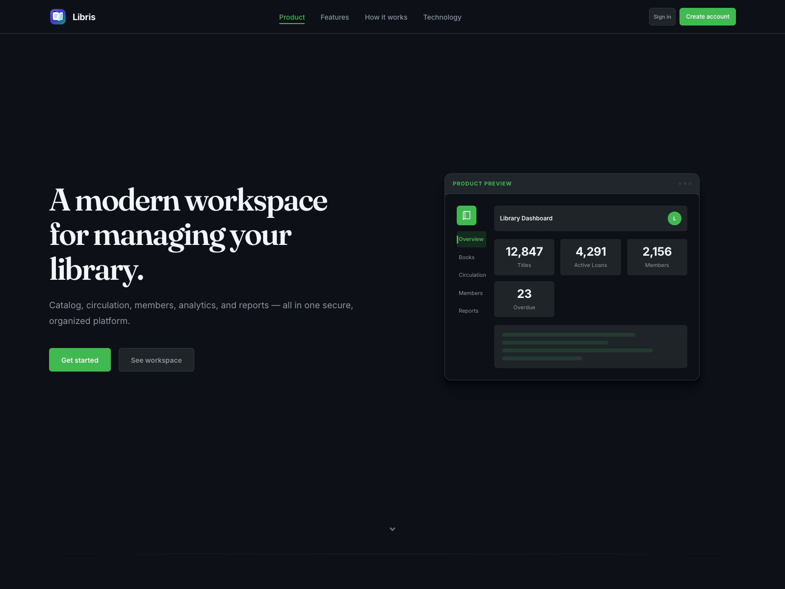
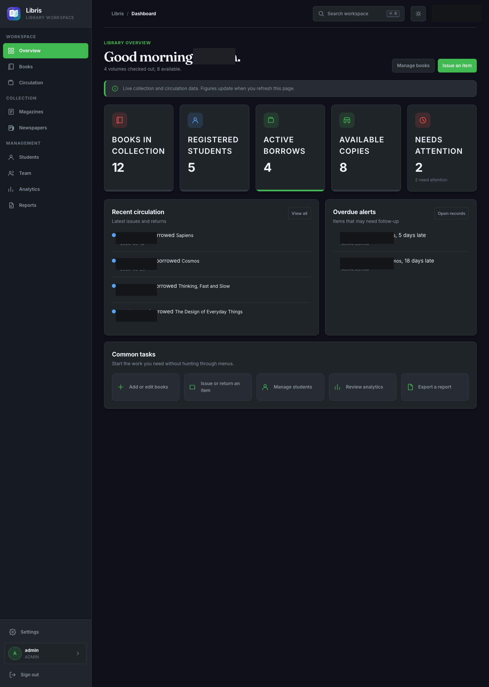
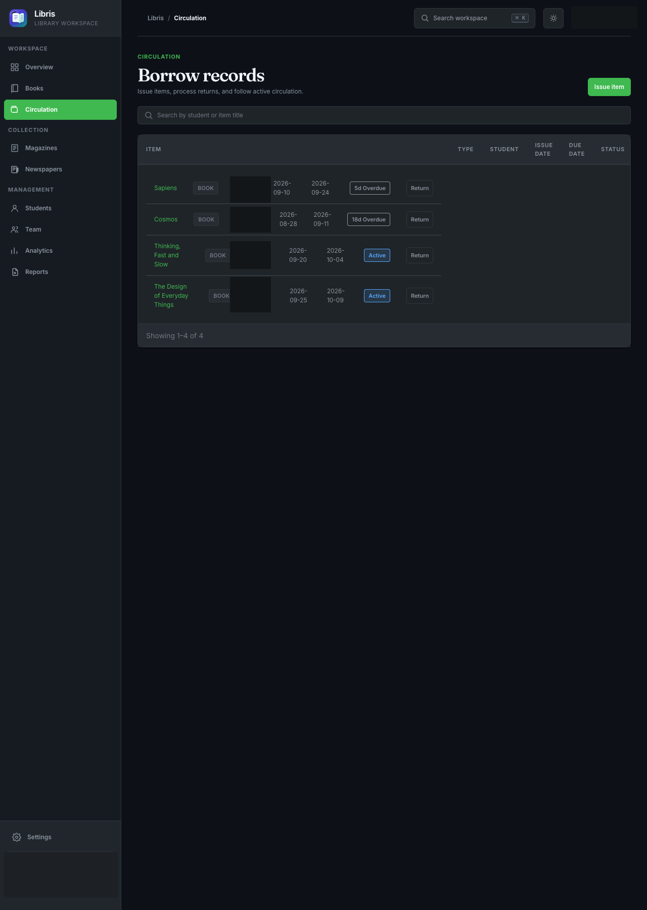
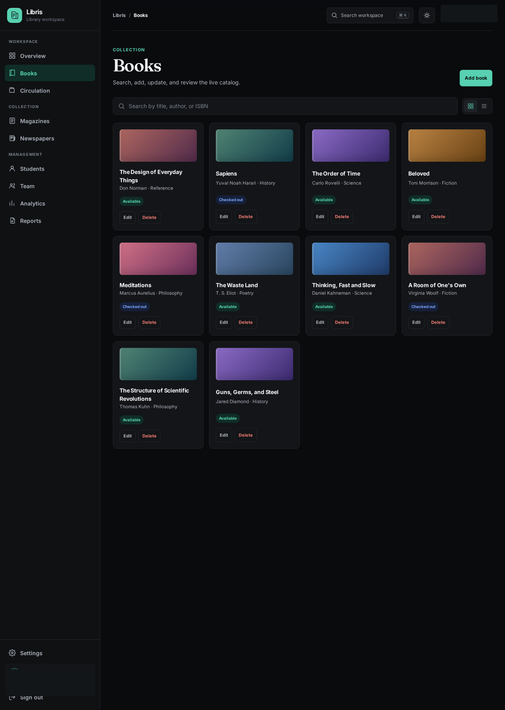
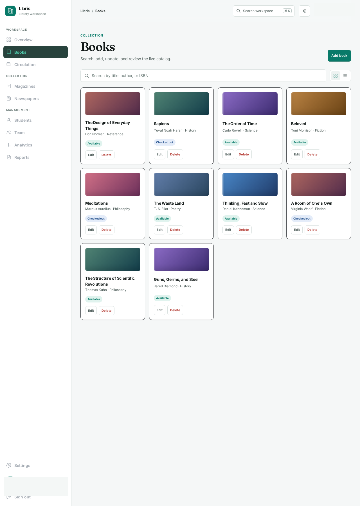
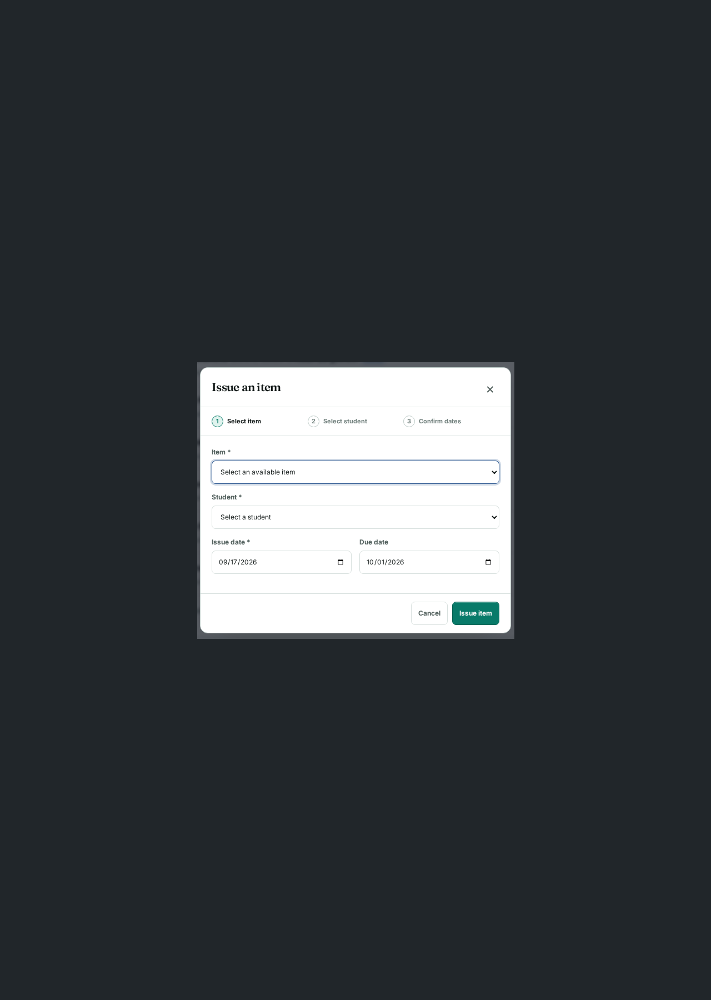
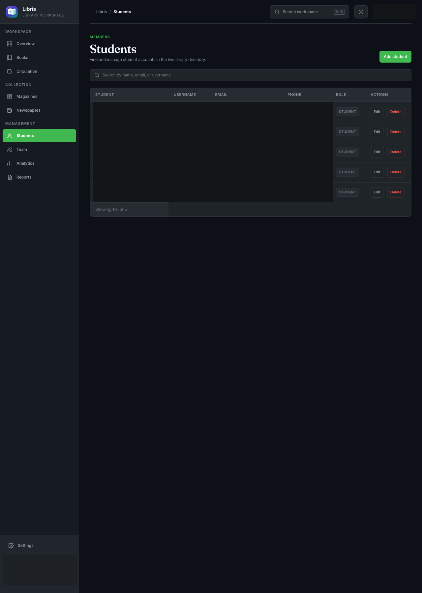
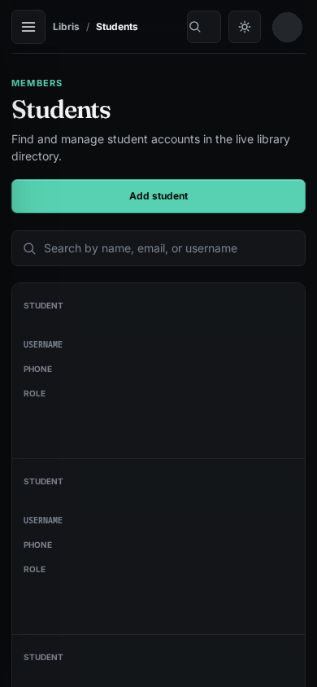
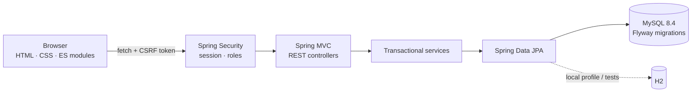

<div align="center">
  

  <h1>Libris</h1>
  <p><strong>A calmer way to run a library.</strong></p>
  <p>Catalogues, circulation, member access and operational insight in one focused web application.</p>

  <p>
    <a href="https://libris.opik.net"><strong>Open the demo</strong></a>
    &nbsp;·&nbsp;
    <a href="docs/SETUP.md">Get started</a>
    &nbsp;·&nbsp;
    <a href="docs/ARCHITECTURE.md">Architecture</a>
    &nbsp;·&nbsp;
    <a href="docs/API.md">API reference</a>
    &nbsp;·&nbsp;
    <a href="https://github.com/prathamkashyap/libris/releases">Releases</a>
  </p>

  <p>
    <a href="https://github.com/prathamkashyap/libris/actions/workflows/ci.yml"></a>
    <a href="https://github.com/prathamkashyap/libris/releases"></a>
    <a href="LICENSE"></a>
    
    
    
    
  </p>

  <br />
  
</div>

---

## At a glance

Libris is a library-management application designed around the everyday work of maintaining a catalogue, managing member accounts, recording loans and returns, and understanding library activity. It brings those workflows together in a single Spring Boot application with a browser interface built from HTML, CSS and native JavaScript modules—**no separate frontend build or deployment is required**.

| Area | What Libris provides |
|---|---|
| **Catalogue** | Books, magazines and newspapers, with search, pagination, categories and ISBN uniqueness checks for books. |
| **Circulation** | Borrow and return workflows, due dates, overdue tracking and retained borrower history. |
| **People and permissions** | `ADMIN`, `LIBRARIAN` and `STUDENT` roles, session login/logout and public student registration. |
| **Operational insight** | Dashboards, borrowing trends, top-book and top-reader views, overdue summaries and CSV reports. |
| **Accountability** | Audit events for catalogue changes and failed login attempts. |
| **Interface** | Responsive multi-page UI, command palette, and dark/light themes. |
| **Engineering** | CSRF protection, structured API errors, Flyway migrations, automated tests and dual-architecture Docker build checks. |

> **Demo and data note:** The starter catalogue is illustrative sample data, not verified physical inventory. The public demo is useful for exploring the interface, not for making real-world availability decisions. The live demo and tagged GitHub releases are separate: a release tag does not deploy the application.

## Product tour

The repository includes selected UI captures so you can see the workflow before running the application.

<table>
  <tr>
    <td width="50%" valign="top"><br /><sub><strong>Dashboard</strong> · Activity and overdue items at a glance.</sub></td>
    <td width="50%" valign="top"><br /><sub><strong>Circulation</strong> · Review active, returned and overdue records.</sub></td>
  </tr>
  <tr>
    <td width="50%" valign="top"><br /><sub><strong>Catalogue</strong> · Search and browse the collection.</sub></td>
    <td width="50%" valign="top"><br /><sub><strong>Two themes</strong> · Light and dark presentation options.</sub></td>
  </tr>
  <tr>
    <td width="50%" valign="top"><br /><sub><strong>Issue workflow</strong> · A guided flow for recording a loan.</sub></td>
    <td width="50%" valign="top"><br /><sub><strong>Members</strong> · Browse the student directory.</sub></td>
  </tr>
</table>

<details>
  <summary><strong>Mobile preview</strong></summary>
  <br />
  
</details>

*Screenshots are committed UI examples. They are not a guarantee that every visible record or state matches the live demo.*

## How it fits together

Libris is a single deployable Spring Boot application. Spring Boot serves the frontend and JSON API from the same origin; browser modules call the API with `fetch`, using the session and CSRF flow. This avoids a separate frontend service and the need for cross-origin API configuration.



### Roles at a glance

| Role | Typical responsibilities |
|---|---|
| **Admin** | Manage the library and librarian accounts. |
| **Librarian** | Maintain the catalogue and students, record circulation, and view analytics and reports. |
| **Student** | Browse the catalogue and view their own profile, dashboard and borrowing history. |

Public registration creates `STUDENT` accounts only. Authorization rules in [`SecurityConfig.java`](backend/src/main/java/com/example/lms/security/SecurityConfig.java) are the source of truth for access control.

## Technology

| Layer | Technology |
|---|---|
| Application | Java 21 · Spring Boot 3.5.0 · Spring MVC · Spring Security |
| Persistence | Spring Data JPA · MySQL 8.4 · H2 for local development and tests |
| Schema evolution | Flyway (`V1`–`V5` in the current source tree) |
| Frontend | HTML · CSS · native JavaScript ES modules; no frontend bundler |
| Quality gates | Maven wrapper · Spotless · JaCoCo line-coverage check |
| CI | GitHub Actions · Java, Node.js, Python and Docker build checks |
| Runtime packaging | Multi-stage Dockerfile · Docker Compose |

### Version baseline

These are the versions this repository actually builds and tests against. They are a deliberate baseline, not a claim of being on the newest upstream releases:

- **Java 21** — an active LTS release with Premier Support to September 2028. The Docker build and runtime stages use Eclipse Temurin 21 images. ([Oracle Java SE Support Roadmap](https://www.oracle.com/java/technologies/java-se-support-roadmap.html))
- **Spring Boot 3.5.0** — pinned in `backend/pom.xml`. Spring published **3.5.16** in June 2026 as the final open-source release of the 3.5.x generation, and recommends 4.0.x or 4.1.x for continued open-source support; the current stable line is 4.1.x. Migrating is a dependency, compatibility and test change tracked as separate work, not a documentation change. ([Spring Boot 3.5.16 announcement](https://spring.io/blog/2026/06/25/spring-boot-3-5-16-available-now))
- **MySQL 8.4** — an active LTS series, used by the Compose stack and the tests. ([MySQL 8.4 release policy](https://dev.mysql.com/doc/refman/8.4/en/mysql-releases.html))

## Get started

Choose the setup that fits what you want to do. The commands below run the application locally; they do not connect to the public demo or use production credentials.

### Option A — H2 development profile

**Requirements:** Java 21. The repository includes a Maven wrapper, so a separate Maven installation is not required.

```sh
git clone https://github.com/prathamkashyap/libris.git
cd libris

# Enter a local admin password without echoing it or adding it to shell history
printf 'Admin password: '
read -r -s LMS_ADMIN_PASSWORD
echo
export LMS_ADMIN_PASSWORD

./mvnw spring-boot:run -Dspring-boot.run.profiles=h2
```

Open <http://localhost:8080> and sign in as `admin` using the password entered above.

- H2 is in-memory and uses `create-drop`; its data is discarded when the process exits.
- The `h2` profile enables Swagger UI at `/swagger-ui.html` for local development.
- Startup requires `LMS_ADMIN_PASSWORD`; do not use production credentials or commit secrets.
- Production session cookies are `Secure`, so plain HTTP is suitable for local checks but not a production-like sign-in test.

### Option B — Docker Compose with MySQL

**Requirements:** Docker Engine and the Compose v2 plugin.

```sh
cp .env.example .env
chmod 600 .env
# Edit .env locally; do not commit it or print its contents.

docker compose up -d --build
docker compose ps
curl -fsS http://127.0.0.1:8080/actuator/health
```

Set `LMS_DB_ROOT_PASSWORD`, `LMS_DB_PASSWORD` and `LMS_ADMIN_PASSWORD` in `.env`. The app is published on `127.0.0.1:8080` by default; MySQL stays on the internal Compose network and is not published on a host port. The production profile uses Secure session cookies, so browser sign-in requires HTTPS from a TLS-terminating proxy.

> **Secret hygiene:** Do not print resolved Compose configuration or environment variables to inspect secrets. Keep `.env` out of source control.

<details>
  <summary><strong>Configuration reference</strong></summary>
  <br />

  | Variable | Purpose |
  |---|---|
  | `LMS_ADMIN_PASSWORD` | Password seeded for the administrator; required by the production profile. |
  | `LMS_ADMIN_USERNAME` | Admin username; defaults to `admin`. |
  | `LMS_DB_ROOT_PASSWORD` | MySQL container bootstrap and health check. |
  | `LMS_DB_PASSWORD` | Password for the application's database account. |
  | `LMS_DB_USERNAME` / `LMS_DB_NAME` | Application database user and schema; Compose defaults are `libris` / `librarydb`. |
  | `LMS_DB_URL` | JDBC connection URL; supplied by Compose for the bundled stack. |
  | `LMS_BIND_ADDRESS` | Host bind address; defaults to `127.0.0.1`. |
  | `JAVA_OPTS` | JVM runtime options, including memory sizing. |
  | `GOOGLE_CLIENT_ID` / `GOOGLE_CLIENT_SECRET` | Optional Google OIDC configuration for the `oauth` profile. |

  Profiles include `h2` for in-memory development, the default/Compose MySQL profile, `prod` for production settings, and optional `oauth` configuration. See [Local setup](docs/SETUP.md) for the complete requirements and profile details.
</details>

## Tests and continuous integration

Run the relevant suites separately and record which ones passed. Passing one suite does not imply that the others passed.

```sh
./mvnw spotless:check
./mvnw clean verify
node --test backend/src/test/js/registration-errors.test.mjs
node --test scripts/catalog-seed/*.test.mjs
python3 -m unittest discover -s scripts/dev-seed -p 'test_phase5*.py'
```

GitHub Actions runs Maven formatting and verification, registration and catalog-importer JavaScript tests, Phase 5 Python tests, and build-only Docker checks for `linux/amd64` and `linux/arm64`. The Docker job is a portability check: **CI does not publish images or deploy the application**. Production updates follow the operator runbook as a manual image-build/transfer and app-only rollout. See [Testing](docs/TESTING.md) and [Deployment](docs/DEPLOYMENT.md).

## Security and operational design

- **Session security:** BCrypt password hashing, server-side sessions and CSRF protection for state-changing browser requests.
- **Production cookies:** `Secure` and `SameSite=Lax`, with forwarded-header support for a TLS-terminating proxy.
- **Access boundaries:** Role-based URL authorization; public self-registration creates student accounts only.
- **Concurrency:** Pessimistic locking protects borrow/return operations from conflicting concurrent updates.
- **Schema ownership:** Flyway manages production schema changes; Hibernate does not update the production schema automatically.
- **Management surface:** Production exposes Actuator health only, with health details hidden; SpringDoc is disabled.
- **Network defaults:** The app binds to loopback in the Compose setup, and MySQL is not exposed on a host port.

Review [Security](docs/SECURITY.md) and [Deployment](docs/DEPLOYMENT.md) before operating a public instance.

## Repository map

```text
backend/                 Spring Boot application, migrations, frontend and tests
  src/main/java/          Controllers, services, entities, repositories and security
  src/main/resources/     Properties, Flyway SQL, HTML/CSS/JavaScript and brand assets
scripts/catalog-seed/     Explicitly invoked authenticated catalogue importer
scripts/dev-seed/         Synthetic data and offline forecasting experiments
scripts/dev-realdata/     Real-data readiness methodology; not a production ML service
docs/                     Setup, API, architecture, database, security and operations
screenshots/              Current UI captures; legacy/ contains earlier captures
Dockerfile                Multi-stage application image build
docker-compose.yml        App + MySQL stack
README.md                 Project overview and entry point
```

The optional catalog importer is an explicitly invoked CLI; it does not run at application startup. It supports preview, apply and rollback, and has its own safety notes in [Catalog seeding](docs/CATALOG_SEED.md).

## Scope and known limitations

Libris documents its current boundaries rather than presenting planned work as shipped functionality:

- **No copy-level inventory:** Availability is a Boolean on a catalogue row; several independently borrowable physical copies of one title are not modelled.
- **Illustrative starter data:** The included sample catalogue is not verified library stock or a live news feed.
- **Registration hardening:** Public student registration does not currently include email verification or CAPTCHA. Assess abuse controls before unrestricted public enrollment.
- **Account recovery:** A password reset/recovery flow is not currently provided.
- **Login failure tracking:** Failed-login tracking is in memory, not a durable distributed rate limiter.
- **Forecasting is separate:** The synthetic-data forecasting experiments run offline and are not integrated into the live application.
- **Deployment provenance:** The repository workflow builds and tests but does not deploy. The Docker image does not embed a Git revision label, so the running image cannot identify its source commit on its own; keep source SHA, image ID and deployment records together.

## Documentation

| Guide | What it covers |
|---|---|
| [Setup](docs/SETUP.md) | Local development, Compose, profiles and environment variables |
| [Architecture](docs/ARCHITECTURE.md) | Application layers and request flow |
| [API reference](docs/API.md) | Route families, errors and CSRF flow |
| [Database](docs/DATABASE.md) | Entities, migrations and persistence constraints |
| [Security](docs/SECURITY.md) | Authentication, authorization, cookies and known risks |
| [Testing](docs/TESTING.md) | Test suites and what they do—and do not—prove |
| [Deployment runbook](docs/DEPLOYMENT.md) | Image build/transfer, app-only rollout, backup and rollback |
| [Catalog seeding](docs/CATALOG_SEED.md) | Importer behavior, manifest and recovery rules |
| [Current state](docs/CURRENT_STATE.md) | Distinguishes source facts from historical operator reports |
| [Changelog](docs/CHANGELOG.md) | Project change history |

## Contributing

Contributions are welcome. Keep changes focused, update the relevant documentation and run the checks applicable to your changes. Start with [CONTRIBUTING.md](CONTRIBUTING.md).

## License

Libris is released under the [MIT License](LICENSE).

<div align="center">
  <sub>Built with Java, Spring Boot and vanilla JavaScript.</sub>
</div>
